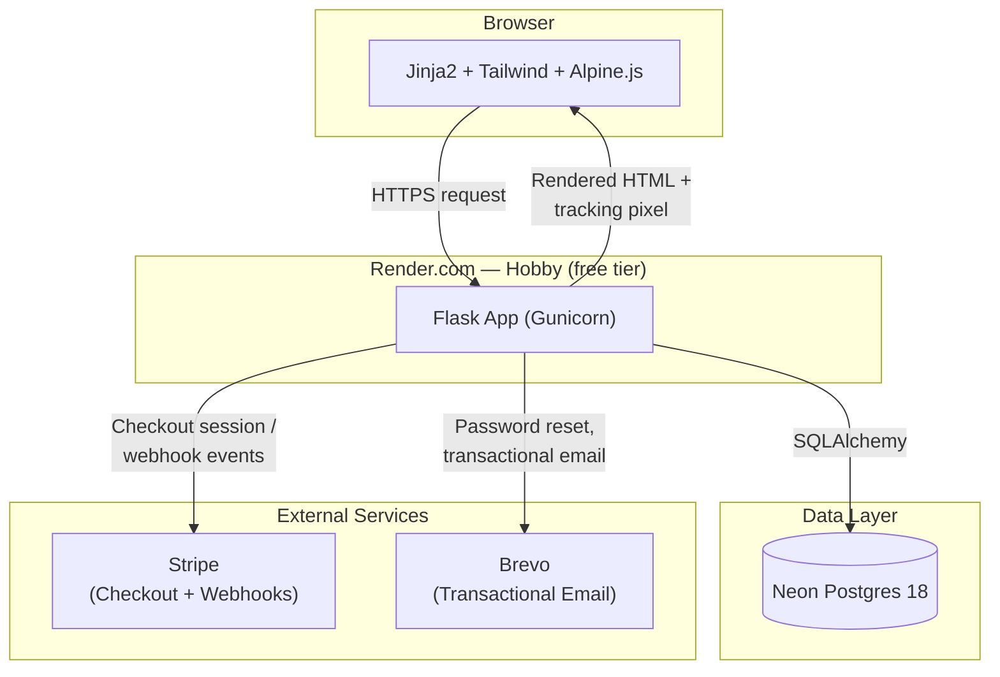
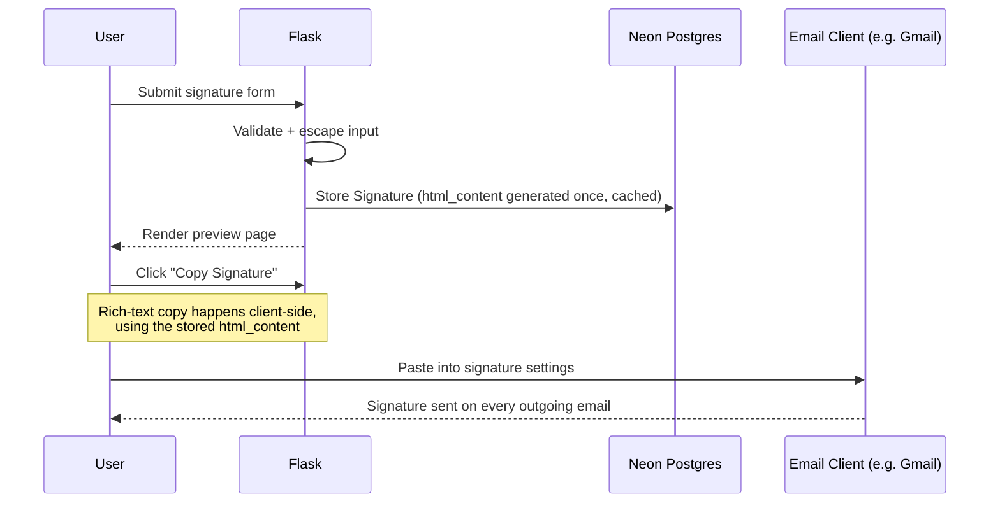

# Architecture Documentation — Signature

**Live app:** https://signature-j0bv.onrender.com/
**Repo:** https://github.com/marl-Am/signature

This document describes how the system is put together, how data flows through it, how security is enforced, and includes a written case study of a real production incident diagnosed and fixed after launch.

---

## 1. High-Level Architecture

The app is a single Flask service — no microservices, no message queue, no separate frontend build step. That's a deliberate choice for a zero-cost MVP: fewer moving parts means fewer things that can fail on a free-tier host, and it keeps the whole system explainable in a single sitting, which matters for a portfolio piece meant to be walked through in an interview.

---

## 2. Component Breakdown

### Routes (Blueprints)
Each Blueprint owns one area of responsibility and enforces ownership checks locally rather than relying on a single global filter:

| Blueprint | Responsibility |
|---|---|
| `auth` | Registration, login, logout, password reset |
| `dashboard` | Signature list view, entry point after login |
| `signatures` | Create, edit, preview, delete signatures |
| `tracking` | Pixel-hit and click-redirect endpoints (public, unauthenticated by necessity) |
| `analytics` | Per-signature and aggregate engagement views |
| `billing` / `subscription` | Stripe Checkout session creation, webhook handling, plan management |
| `profile` | Account settings |

### Services
Business logic is kept out of routes and lives in `app/services/`:

- **`signature_service.py`** — builds the actual signature `html_content` from user-supplied fields across seven layouts (classic, modern, minimal, ruled, avatar, compact, banner). This is the single source of truth for what a signature looks like; the in-app preview and the copied output both trace back to this function. For free-tier accounts, a "Sent with Signature" watermark line is appended at the single `return` point so it applies uniformly across all seven layouts. The check defaults to showing the watermark if tier data is ever missing, failing closed on this retention feature. The watermark is re-evaluated on every create/edit, not automatically on a Stripe tier change, so an upgrade takes effect on the signature's next save rather than instantly.
- **`analytics_service.py`** — aggregates raw tracking events into the numbers shown on the dashboard, including filtering out known bot and scanner user agents so open/click counts stay meaningful.
- **`email_service.py`** — wraps Brevo for password resets and any transactional email.
- **`user_service.py`** — user creation, plan state, and account-level logic shared across routes.

### Models
Three core tables: `User`, `Signature`, and an analytics/event table recording opens and clicks. Signatures belong to users; tracking events belong to signatures. Access control is enforced by checking record ownership against the logged-in user on every read and write, not by trusting client-supplied IDs.

---

## 3. Data Flow

### Signature creation and delivery

The `html_content` is generated once at save time and stored, rather than regenerated on every preview load. This keeps the preview page fast and means the exact bytes a user copies are the exact bytes that were validated at save time — there's no separate rendering path that could drift from what was tested.

### Tracking flow

Every stored signature embeds a unique tracking pixel URL and, where applicable, redirect-wrapped links. When a recipient opens an email or clicks a link:

1. Their email client requests the pixel image (or follows the redirect link) from the `tracking` blueprint.
2. The request is logged as an event, tagged to the owning signature.
3. Known bot and scanner user agents (email security scanners that pre-fetch links, for example) are filtered out at this stage so they don't inflate engagement numbers.
4. The `analytics` blueprint later aggregates these raw events for the dashboard.

---

## 4. Security Architecture (OWASP Top 10 alignment)

| OWASP Category | How it's addressed here |
|---|---|
| **A01 – Broken Access Control** | Every signature/analytics route checks record ownership against the logged-in user before returning or modifying data. Deny-by-default; no route assumes a client-supplied ID is safe to trust. |
| **A02 – Cryptographic Failures** | Argon2id for password hashing; TLS in transit via Render's managed certificates; secrets loaded from environment variables, never hardcoded. |
| **A03 – Injection** | SQLAlchemy ORM used exclusively — no raw string-built SQL anywhere in the codebase. |
| **A04 – Insecure Design** | Seven signature layouts share one HTML-generation function rather than seven independent code paths, reducing the surface area for design-vs-security drift. |
| **A05 – Security Misconfiguration** | Environment-driven config (`FLASK_ENV=production` on Render); no default credentials; dependency and container scanning via Docker Scout. |
| **A07 – Identification/Auth Failures** | Flask-Login session management; Argon2id password hashing (see A02). |
| **A08 – Software/Data Integrity** | CI (GitHub Actions) runs the full test suite, Ruff, and `ty` on every push before Render's auto-deploy picks it up. |
| **A09 – Logging & Monitoring** | Tracking events are logged with enough context to distinguish real engagement from bot traffic; Render's Events/Deploys tab is checked as part of the standard deploy process. |
| **A10 – SSRF** | No user-supplied URLs are fetched server-side; outbound calls are limited to Stripe and Brevo's known endpoints. |

### Stored XSS remediation (case study)

An earlier session traced a font-rendering display bug back to unescaped user input in the server-side signature HTML builder — a classic stored XSS pattern, where a value like a company name or font selection containing a quote character could break out of its intended context. The fix escaped user-supplied fields consistently and added URL scheme validation (so a field couldn't be used to inject a `javascript:` URL, for example) using Python's standard library rather than a third-party sanitizer, keeping the dependency footprint small. Regression tests for this exact bug class are being added to `tests/test_signatures.py`.

---

## 5. Case Study: The Clipboard-Background Bug

This is included as a full write-up because it's a good example of methodical debugging rather than guessing, and it's a natural thing to walk through in an interview.

**The report:** A user pasted a signature into a fresh Gmail signature slot and saw the entire card rendered with a solid navy-blue background. The in-app Live Preview of that exact same signature showed a clean white background.

**The instinct to avoid:** It would have been easy to assume the bug was in the HTML generator itself, since that's the component that produces the signature's markup and styling. Jumping straight there would have wasted time.

**The actual process, in order:**

1. **Ruled out the client-side Live Preview.** It rendered correctly, so whatever was wrong wasn't visible in the normal preview path.
2. **Ruled out the server-side generator.** `signature_service.py`'s `_generate_html_content()` was read in full — all seven layout branches — and none of them apply a background to the layout in question (`banner`).
3. **Ruled out Gmail itself.** The actual stored `signature.html_content` was extracted directly from the browser console, decoded, and pasted into a standalone local `test.html` file, opened outside the app entirely. It rendered clean, with a white background. This confirmed the stored data was correct — the bug had to be somewhere in how the signature got *from* storage *into* the clipboard.
4. **Found it.** The `Copy Signature` button's click handler built a temporary, off-screen `contenteditable` `
`, appended it to `document.body`, and used `document.execCommand('copy')` to copy it as rich text. That temporary div never set its own background. The site's own `<body>` element carries a `bg-primary` class (navy blue) for the site's page chrome. Chrome's `execCommand('copy')` bakes the computed/inherited background behind a transparent copied element into the clipboard's HTML, for visual-fidelity reasons. So the site's own page background was being silently written into every signature copied through that button — invisible in the app itself because the temporary div is positioned off-screen, and the on-page preview renders inside a separate white "simulated email" card that never shared that inherited background. The bug only surfaced once the signature was pasted somewhere with no competing background of its own, like a real Gmail signature slot.

**The fix:** One line — explicitly setting the temporary element's background to white before its content was set, so there was nothing left for the browser to inherit.

**Why this is worth telling in an interview:** It demonstrates elimination-based debugging (server generator → stored data → client rendering, each checked independently before concluding where the bug actually lived), and it's a reminder that a bug reported against one component ("my signature looks wrong") doesn't mean the fix belongs in that component. This one turned out to be entirely unrelated to signature generation — it was a side effect of how browsers serialize rich-text copies of off-screen elements.

---

## 6. Technology Stack Rationale

- **Flask over a heavier framework:** the app's scope (auth, CRUD on signatures, billing webhooks, tracking endpoints) doesn't need Django's batteries-included surface area, and a smaller framework is easier to fully explain and defend in an interview.
- **Neon Postgres over a self-managed database:** free tier with no hard project-count cap and auto-scale-to-zero when idle, which matches the project's zero-cost constraint without giving up a real production-grade database engine.
- **Brevo over a paid transactional email provider:** 300 emails/day on a permanent free tier is more than sufficient for a portfolio-scale project, without a time-limited trial that would eventually break the demo.
- **Alpine.js over a full frontend framework:** the UI's interactivity (tabs, toggles, small client-side state) doesn't need a build step or a virtual DOM; Alpine's small footprint keeps the project dependency-light and the templates readable as plain HTML with light annotations.
- **Render's free tier over a paid host:** accepts the tradeoff of a 15-minute idle spin-down in exchange for zero ongoing cost, which is an explicit, explainable limitation rather than an accidental one.

---

## 7. Known Limitations (by design, not oversight)

- **No custom domain yet** — running on Render's free `*.onrender.com` subdomain deliberately, pending budget for a ~$10-12/year domain purchase.
- **Free-tier cold starts** — the app sleeps after 15 minutes of inactivity and takes 30-60 seconds to wake on the next request.
- **Stripe in test mode** — moving to live payments requires business verification (EIN/SSN, bank account, business type) and isn't worth doing until there's an actual plan to onboard paying users.
- **Outlook and Apple Mail delivery** — validated in the UI's install instructions, but the full create-to-receive pipeline has so far only been confirmed end to end in Gmail; Outlook and Apple Mail testing is a planned next step.